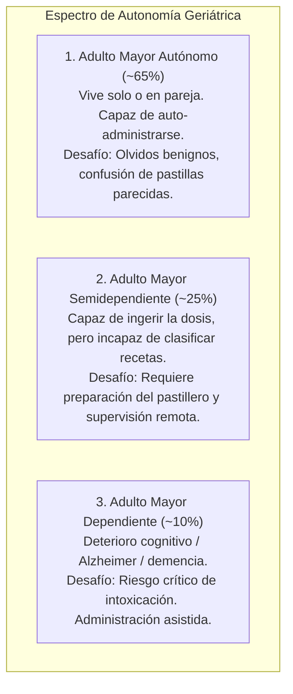
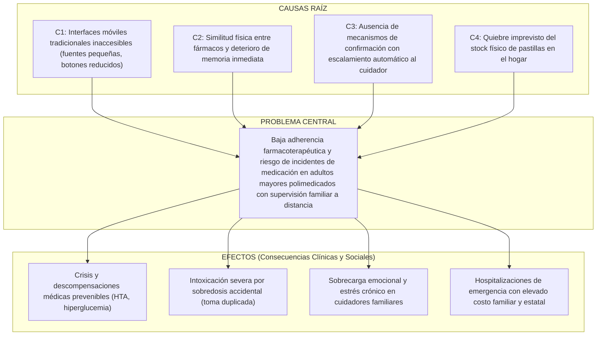
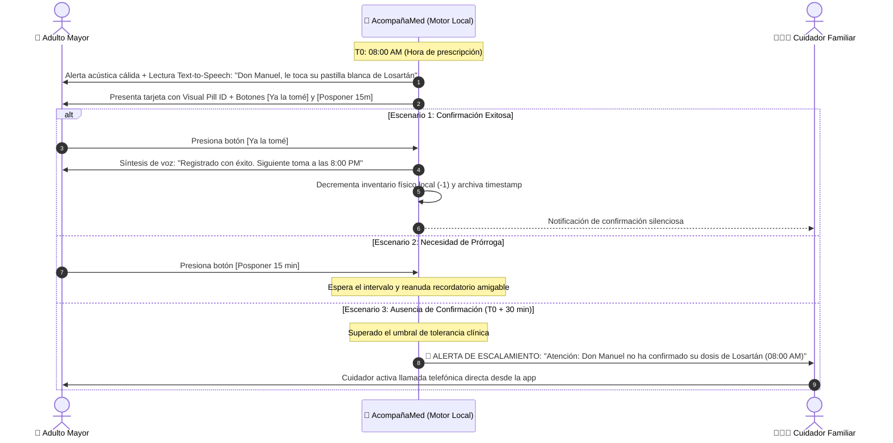

# AcompañaMed — Documento Maestro de Diseño y Especificación Técnica

## 1. Identidad del Proyecto

* **Nombre Oficial**: **AcompañaMed**
* **Lema**: *"Tranquilidad para tu familia, salud a tiempo para ti"*
* **Enfoque de Proyección Social**: Salud pública gerontológica, reducción de incidentes por polifarmacia y mitigación de la sobrecarga del cuidador (*caregiver burnout*) en familias de la región.
* **Paradigma Tecnológico**: Aplicación móvil multiplataforma desarrollada en **React Native con TypeScript**, diseñada bajo directrices de accesibilidad universal (WCAG 2.1 AAA) y arquitectura offline-first.

---

## 2. Fundamentación Ética y Gerontológica

En geriatría y salud comunitaria, el adulto mayor no constituye un grupo homogéneo. La solución se fundamenta en la **Escala de Autonomía Funcional** (adaptación de las escalas de Barthel y Katz para Actividades de la Vida Diaria):



### Principios Rectores:
1. **Preservación de la Autonomía y Autoestima**: Según directrices de la OMS, retirar la autogestión a un adulto mayor funcional deteriora su salud cognitiva y genera frustración. AcompañaMed empodera al adulto mayor con una interfaz libre de fricciones.
2. **Red de Seguridad No Invasiva**: El paciente mantiene el control de su día a día sin sentirse vigilado, mientras que el familiar conserva la certeza de que el sistema alertará proactivamente solo ante anomalías o ausencias de confirmación.
3. **Eliminación de la Brecha Digital (Modo Dual)**: Si el paciente no puede o no desea manipular un smartphone, el sistema se conmuta fluidamente a **Modo Cuidador Presencial**, garantizando que ninguna persona quede excluida por barreras tecnológicas.

---

## 3. Árbol de Problemas Formal

Este modelo causa-efecto sustenta la formulación de requerimientos y la justificación académica requerida en la rúbrica del laboratorio:



---

## 4. Matriz de Actores del Ecosistema

| Actor | Perfil y Limitaciones | Responsabilidades en AcompañaMed | Beneficio Directo |
| :--- | :--- | :--- | :--- |
| **👴 Adulto Mayor (Paciente)** | Visión reducida, temblor fino, baja tolerancia a interfaces complejas. Busca autonomía. | Visualiza la dosis actual, escucha instrucciones por voz, confirma o pospone la toma con 1 toque, activa SOS si se siente mal. | Autonomía personal, seguridad al tomar la medicina correcta, sin confusión visual. |
| **👨‍👩‍👧 Cuidador Principal (Familiar)** | 30-55 años, jornada laboral activa, vive en el mismo hogar o a distancia. Sufre estrés por falta de visibilidad. | Registra medicamentos y horarios, asigna forma/color visual, recibe alertas si la toma no se confirma, monitorea el inventario. | Tranquilidad mental (*peace of mind*), alertas oportunas para intervenir a tiempo sin atosigar. |
| **🩺 Médico / Geriatra (Consumidor indirecto)** | Profesional de salud que atiende las consultas periódicas de control. | Consulta el reporte de cumplimiento terapéutico (% de dosis a tiempo vs. omitidas). | Diagnóstico certero; evita alterar prescripciones por falso supuesto de ineficacia clínica. |

---

## 5. Dinámica Operativa y Ciclo de Vida de una Dosis

### Protocolo de Escalamiento Escalonado (Escalated Reminder Loop)



### Mitigación de Tomas Falsas ("Marcar por marcar")
1. **Visual Pill ID**: Cada tarjeta de medicamento contiene forma gráfica (redonda, cápsula, ovalada) y color primario (blanco, azul, rojo, amarillo), forzando el emparejamiento visual con el blíster real.
2. **Botón [Posponer] sin culpa**: Ubicado con la misma jerarquía que confirmar, eliminando el incentivo de mentirle al sistema para apagar la alarma.
3. **Bloqueo Incondicional de Duplicidad**: Una vez confirmada una toma, el botón queda deshabilitado para esa ventana horaria con la leyenda: *"Dosis de hoy registrada a las 08:03 AM. Siguiente toma a las 20:00 PM"*.
4. **Validación Cruzada de Stock**: El inventario digital descontado debe coincidir periódicamente con las pastillas físicas restantes en el pastillero.

---

## 6. Módulos y Requisitos del Sistema

### Requisitos Funcionales (RF)
* **RF-01 (Modo Dual de Arranque)**: Selección de perfil en primera ejecución: *Modo Senior* (alta accesibilidad) o *Modo Cuidador* (gestión y analítica).
* **RF-02 (Catálogo de Medicamentos & Visual Pill ID)**: Registro de fármaco con nombre genérico/comercial, dosis, intervalo horario, icono morfológico y color representativo.
* **RF-03 (Alarma Sonora & Síntesis Text-to-Speech)**: Reproducción de voz sintetizada en español nativo con la instrucción exacta de la toma.
* **RF-04 (Gestor de Confirmación y Prórroga)**: Botones táctiles extendidos (>56dp) para registro inmediato o aplazamiento controlado (15 min).
* **RF-05 (Motor de Escalamiento al Cuidador)**: Disparo de alerta crítica a la red de apoyo tras 30 minutos de inacción del paciente.
* **RF-06 (Botiquín & Alerta de Quiebre de Stock)**: Control de existencias con aviso preventivo cuando resten menos de 3 días de tratamiento.
* **RF-07 (Botón de Asistencia SOS)**: Acceso directo en pantalla principal para enlazar llamada telefónica inmediata con el cuidador o servicios de emergencia (106 SAMU / 116 Bomberos).
* **RF-08 (Panel de Adherencia y Estadísticas)**: Cálculo del porcentaje de cumplimiento semanal/mensual con discriminación de tomas a tiempo, pospuestas y omitidas.
* **RF-09 (Toma Presencial Asistida)**: Opción para que el cuidador registre manualmente la administración directa al paciente dependiente.
* **RF-10 (Persistencia y Sincronización Local)**: Operatividad completa sin conexión a internet (offline-first).

### Requisitos No Funcionales (RNF)
* **RNF-01 (Accesibilidad WCAG 2.1 AAA)**: Contraste de color superior a 7:1 en textos principales, tipografía escalable sans-serif legible y áreas de toque mínimas de 48x48dp.
* **RNF-02 (Latencia de Respuesta)**: Confirmación de toma y feedback háptico/vocal en menos de 300 ms.
* **RNF-03 (Privacidad de Datos Médicos)**: Almacenamiento seguro en el dispositivo sin exposición no autorizada de historiales clínicos.

---

## 7. Arquitectura Técnica (React Native + TypeScript)

* **Framework Principal**: React Native 0.74+ con TypeScript estricto.
* **Motor de Notificaciones**: `expo-notifications` (o `notifee`) para alarmas exactas programadas en background y compatibilidad Android/iOS.
* **Accesibilidad Vocal**: `expo-speech` para motor de Text-to-Speech nativo en español latinoamericano.
* **Persistencia de Datos**: `@react-native-async-storage/async-storage` con capa tipada de repositorios (`MedicineRepository`, `DoseLogRepository`).
* **Respuesta Háptica**: `expo-haptics` para confirmación por vibración táctil ante toques exitosos.
* **Estructura Modular**:
  ```text
  src/
  ├── domain/          # Entidades (Medicine, DoseSchedule, CaregiverAlert)
  ├── infrastructure/  # Storage, NotificationService, SpeechService
  ├── presentation/    # Modos Senior y Cuidador, componentes accesibles
  └── state/           # Hooks y gestión reactiva del estado
  ```

---

## 8. Cronograma y Entregables del Laboratorio 5

1. **Sprint 1 (Semana 1)**:
   * Inicialización del proyecto React Native con TypeScript y dependencias de accesibilidad.
   * Modelado de dominio y repositorios locales.
   * Implementación de la vista Senior (Visual Pill ID, botones gigantes, Text-to-Speech).
   * Motor de recordatorios locales y confirmación de tomas.
2. **Sprint 2 (Semana 2)**:
   * Implementación del Modo Cuidador (gestión de inventario de stock y panel de adherencia).
   * Módulo de escalamiento de alertas y botón SOS.
   * Pruebas de integración, capturas de pantalla de la app en ejecución.
   * Redacción y compilación del informe oficial en formato Word (DOCX) cumpliendo estrictamente con la rúbrica del docente.
